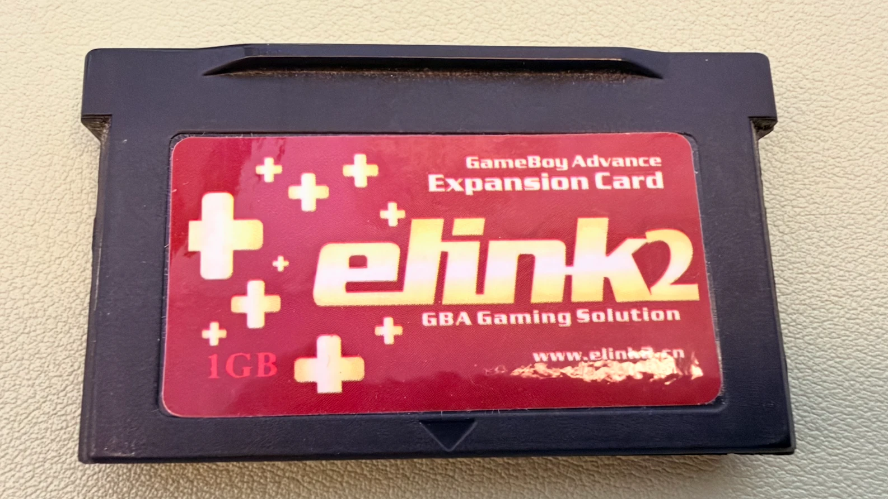
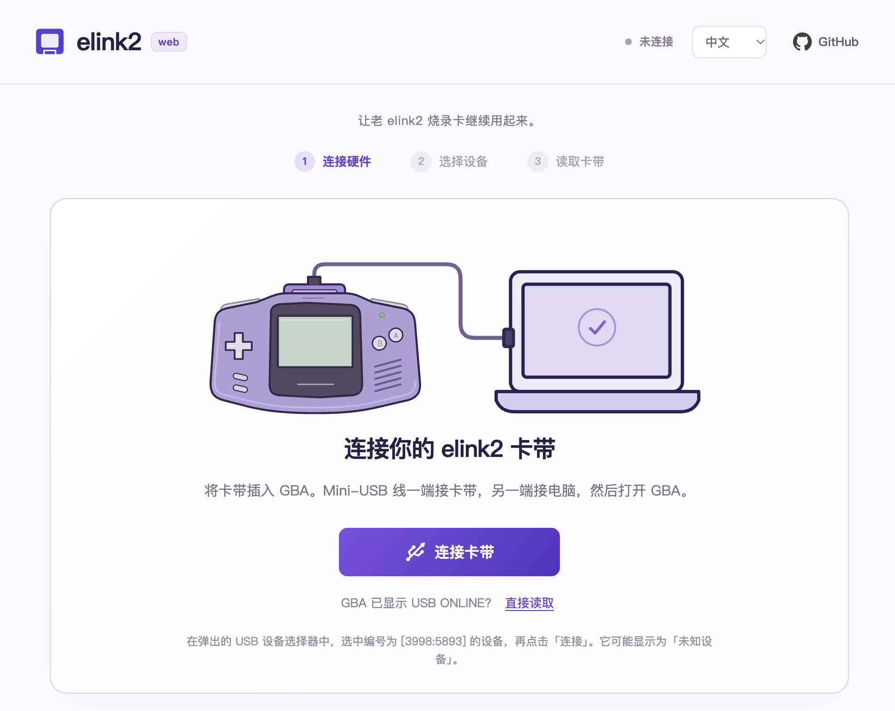
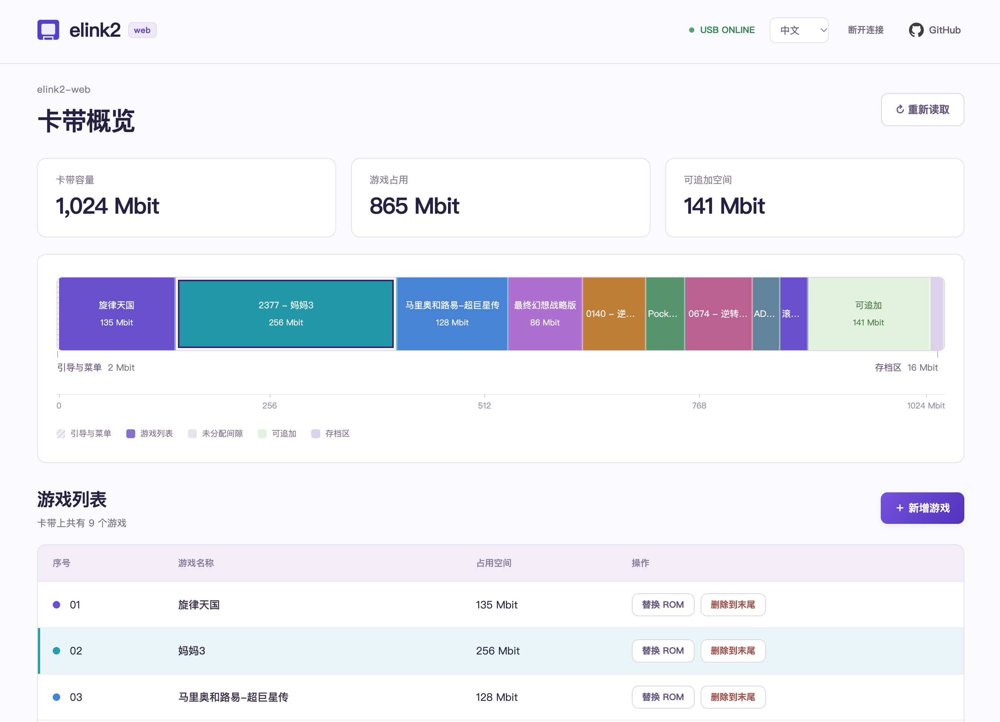
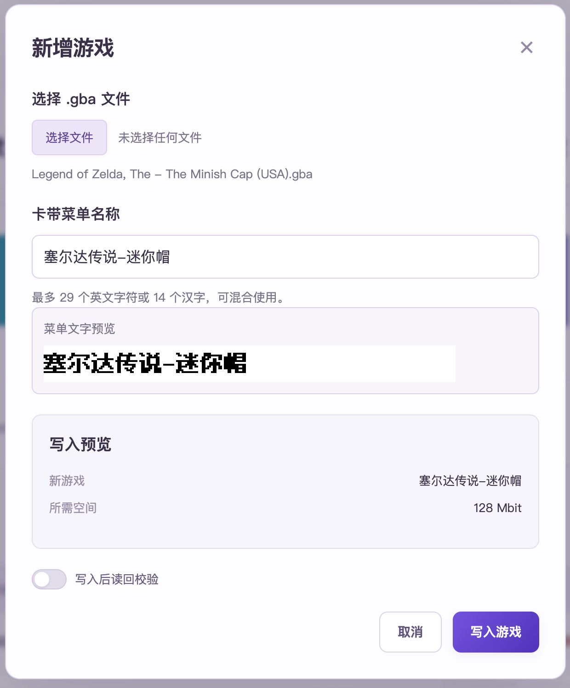

# elink2-web

[中文](README.md) · English

Keep your elink2 flash cart going — flash GBA games from your browser.

## Why I built this

I recently dug out my Game Boy Micro (GBM) and the elink2 flash cart I used back in the day, hoping to revisit some classic games. I soon found that the cart had long been discontinued, with little discussion or documentation online and no usable driver I could find for macOS.

With help from AI, I had Codex analyze the original elink2 Windows software. Using that analysis and the few software screenshots I could find online, I gradually put together this web tool.

I can now keep using my old cart on macOS. I hope this helps others who still have an elink2 tucked away, too.



## Using the tool

A small, local-first web tool for elink2. Connect the **Mini-USB port on the cart** to your computer, put the cart in a GBA, turn it on, then click **Connect cart**. Choose the connected device in Chrome’s USB picker and confirm. If the GBA already says `USB ONLINE`, use **Read directly**.

Currently supports viewing the cart storage map and game list, adding and replacing games, and deleting a selected game and all games after it.

### Screenshots

**Connect the cart**



**Storage map and game list**



**Write a game and customize its menu title**



### Planned features

- Save import and export
- Cheat support

### Development

Use Node.js 22.12+ (Node 24 LTS recommended).

```sh
npm ci
npm run dev
```

Open the localhost URL in desktop Chrome. WebUSB needs a secure context (HTTPS or localhost). Other apps using the cart must be closed. No USB operation starts automatically on page load. Initialization sends the fixed, checksum-verified SHOW3 payload to the cart.

```sh
npm test
npm run build
npm run preview
```

### Current write boundaries

- USB VID/PID `3998:5893`, configuration 1/interface 0/alternate 0, and the known `Mits1024 V3.39C` 192-byte header identity are checked. Other identities remain read-only.
- The map represents the known **128 MiB address window**, not detected physical capacity. The first 256 KiB is boot/menu, and the last 2 MiB contains save slots. Internal gaps are distinct from the appendable tail. Unknown/malformed layouts disable writing.
- Delete to end removes the selected game and all following entries from the menu, reclaiming the continuous tail for new games. It updates menu status fields; old ROM and save bytes remain until overwritten. The confirmation lists affected games and reclaimed space.
- Append uses a consecutive free menu slot and continuous tail space. Replacement must fit within the selected game’s extent. The ROM header is normalized and a simple bitmap title is generated. General ROM save patches and save-format conversion are not implemented.
- Clicking Write game checks that the menu snapshot is current and that the cart identity matches, then writes the ROM and menu.
- Immediately before writing, the current menu is read and compared with the displayed snapshot. The optional Read back and verify after writing checkbox is off by default. When enabled, the ROM is fully read back before the menu is written, then the menu and 192-byte boot identity are checked. With it off, completion follows the device write status and no post-write reads occur. The finish command ends the session; no reads follow it.
- A partially failed write stops and requires inspection. There is no automatic retry or rollback. Keep the operation log.
- Real hardware behavior was established in the predecessor macOS/WebUSB prototype on one cart. This new app still needs its own hardware acceptance run. Automated tests use a simulated USB device, not a physical cart.

### Provenance

Protocol framing, ROM header normalization, menu layout and SHOW3 initialization are based on reverse engineering of the vendor utility. `public/show3.bin` is the existing zero-padded SHOW3 initialization candidate extracted from the vendor utility, SHA-256 `9911c054083b600eff12b07ac6a8bf97931cbf032b5aa7bf59203263cab6e7c3`. It is not a newly authored firmware image.

### Cart menu titles

New and replacement games can use a custom menu title. Titles use the cart's
legacy Chinese encoding and are limited to 29 bytes plus a NUL terminator.
The fixed 12px bitmap font is bundled locally from
[Fusion Pixel](https://github.com/TakWolf/fusion-pixel-font), release 2026.10.25;
its OFL and component licenses are in `public/menu-font-licenses`.
`python3 scripts/subset-menu-font.py /path/to/release.zip` reproduces the GBK subset.
The bitmap uses MSB-first set bits for text and zero bits for background.
The preview decodes the same bitmap bytes that will be written to the cart.

Menu glyphs are emboldened by one horizontal pixel with a blank column between
characters. The browser preview uses black ink on white; this display palette
does not alter the bitmap polarity or the cartridge menu's colors.

## License

Original project code, documentation and artwork are licensed under the
[MIT License](LICENSE). Third-party materials are excluded from that grant:

- Fusion Pixel bitmap data (`src/menu-font.json`): SIL OFL 1.1;
  original and component notices are in [`public/menu-font-licenses`](public/menu-font-licenses).
- Lucide USB icon: [ISC license](public/lucide-license.txt).
- GitHub Octicons icon: [MIT license](public/octicons-license.txt), with its original copyright notice.
- `public/show3.bin` and its build copy: a vendor-derived initialization resource,
  excluded from this project's MIT license. No redistribution license has been
  identified; inclusion here does not grant redistribution rights.
