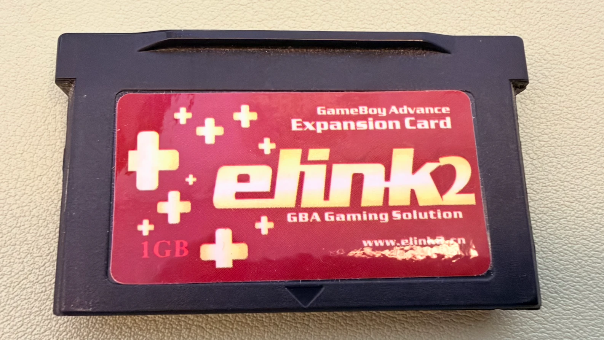
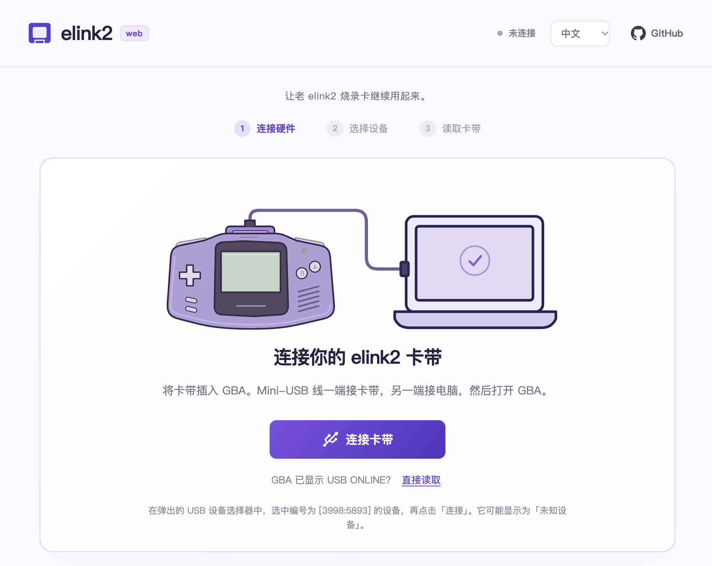
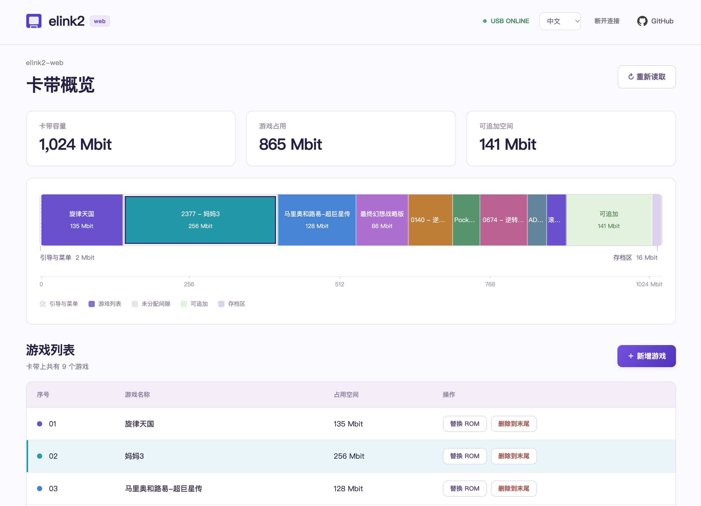
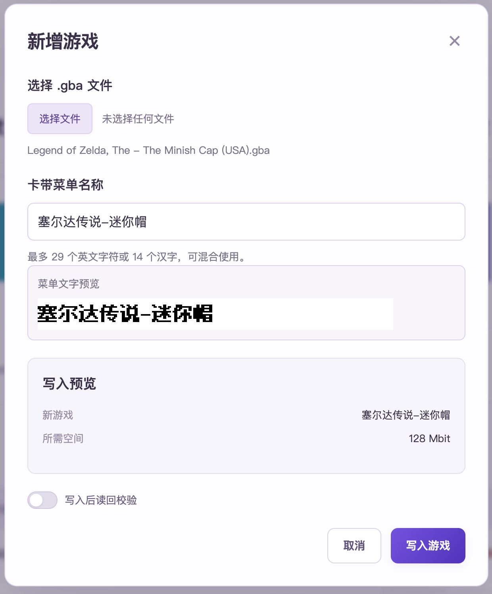

# elink2-web

让老 elink2 烧录卡继续用起来，在浏览器里烧录 GBA 游戏。

中文 · [English](README.en.md)

## 为什么做这个工具

最近，我翻出了自己的 Game Boy Micro（GBM）和当年使用的 elink2 烧录卡，想重温一下经典游戏。这才发现，这款烧录卡早已停产，网上相关的讨论和资料也不多，在 macOS 上更是找不到可用的驱动。

于是，我借助 AI，让 Codex 分析原版 elink2 的 Windows 程序，再参考网上零星的软件截图，一点点做出了这个 Web 工具。

现在，我在 macOS 上也能继续使用这张老卡了。希望这个工具也能帮到同样还留着 elink2 烧录卡的人。



## 使用说明

一个基于 WebUSB、在浏览器本地运行的 elink2 烧录工具。把 elink2 烧录卡插入 GBA，将 USB 线的 Mini-USB 一端接到**卡带上的接口**，另一端接电脑，再打开 GBA 电源。点击「连接卡带」，在 Chrome 弹出的设备选择器中选中刚接入的设备并确认连接。如果 GBA 已显示 `USB ONLINE`，可以使用「直接读取」。

目前支持展示卡带存储分布图、查看游戏列表、新增游戏、替换游戏，以及删除选中游戏及其后的全部游戏（删除到末尾）。

### 界面预览

**连接卡带**



**存储分布图与游戏列表**



**写入游戏与自定义菜单名称**



### 待实现

- 存档导入与导出
- 金手指功能

### 本地开发

需要 Node.js 22.12 或更高版本，推荐 Node.js 24 LTS。

```sh
npm ci
npm run dev
```

在桌面版 Chrome 中打开终端给出的本地地址。WebUSB 需要 HTTPS 或 localhost 安全上下文；请关闭其他正在使用卡带的程序。页面加载时不会自动执行 USB 操作，连接初始化会向卡带发送固定且经过校验的 SHOW3 数据。

```sh
npm test
npm run build
npm run preview
```

### 当前写入范围与限制

- 检查 USB VID/PID `3998:5893`、配置 1、接口 0、备用设置 0，以及已知 `Mits1024 V3.39C` 的 192 字节启动头身份；其他身份仅允许读取。
- 存储图展示已知布局的 **128 MiB 地址窗口**，并非检测得到的物理容量。前 256 KiB 为启动和菜单区域，最后 2 MiB 为存档槽。内部空隙与末尾可追加空间分别展示，未知或异常布局会禁用写入。
- 「删除到末尾」会从选中的游戏开始，移除它及后续全部菜单项，腾出连续空间供新增游戏使用。操作仅更新菜单状态，旧 ROM 和存档数据保留到后续覆盖时；确认窗口会列出受影响的游戏和可腾出空间。
- 新增游戏使用连续的空闲菜单槽和末尾空间；替换游戏必须能放入原游戏所在的空间。写入时会规范化 ROM 头部并生成菜单字模，尚未实现通用存档兼容补丁或存档格式转换。
- 点击「写入游戏」后会检查菜单快照是否仍为当前版本、卡带身份是否匹配，再写入 ROM 和菜单。
- 写入前会读取当前菜单并与页面快照比较。「写入后读回校验」默认关闭；开启后，先完整读回 ROM，再写入菜单，并校验菜单和 192 字节启动头身份。关闭时以设备返回的写入状态作为完成依据，不进行写后读回。结束命令发出后会关闭会话，不再追加读取。
- 写入部分失败后会停止，不会自动重试或回滚。请保留操作日志并检查卡带。
- 前身 macOS/WebUSB 原型在一张卡带上建立了实机证据，此 Web 应用仍需单独进行完整实机验收。自动化测试使用模拟 USB 设备。

### 实现来源

USB 协议帧、ROM 头部规范化、菜单布局和 SHOW3 初始化流程基于原厂工具的逆向分析实现。`public/show3.bin` 是从原厂工具提取并补零的既有 SHOW3 初始化文件，SHA-256 为 `9911c054083b600eff12b07ac6a8bf97931cbf032b5aa7bf59203263cab6e7c3`，不是本项目新编写的固件。

### 卡带菜单文字

新增或替换游戏时可以自定义卡带菜单名称。名称使用卡带原有的中文编码，最多 29 字节并以 NUL 结尾，通常相当于 29 个英文字符或 14 个汉字，同时受实际显示宽度限制。

字形使用随项目提供的固定 12 像素点阵，来自 [Fusion Pixel](https://github.com/TakWolf/fusion-pixel-font) 的 2026.10.25 版本；字体及其组成部分的授权声明保存在 `public/menu-font-licenses`。可以运行 `python3 scripts/subset-menu-font.py /path/to/release.zip` 重新生成 GBK 字符子集，不依赖操作系统字体，也不会从第三方加载字体。

字模按高位在前排列，笔画为 1、背景为 0。预览和写入共用同一份位图数据。

笔画横向加粗 1 像素，并保留字间空隙。网页预览使用白底黑字，这一预览配色不改变字模位值或卡带菜单的颜色。

## 许可证

本项目原创代码、文档和图形采用 [MIT 许可证](LICENSE)。以下第三方资源不属于该授权范围：

- Fusion Pixel 字模数据（`src/menu-font.json`）：SIL OFL 1.1，字体及其组成部分的声明保存在 [`public/menu-font-licenses`](public/menu-font-licenses)。
- Lucide USB 图标：[ISC 许可证](public/lucide-license.txt)。
- GitHub Octicons 图标：[MIT 许可证](public/octicons-license.txt)，保留其原始版权声明。
- `public/show3.bin` 及其构建副本：来自原厂程序的初始化资源，不纳入本项目 MIT 授权，目前尚未确认其再分发许可；本项目不授予该文件的再分发权利。
